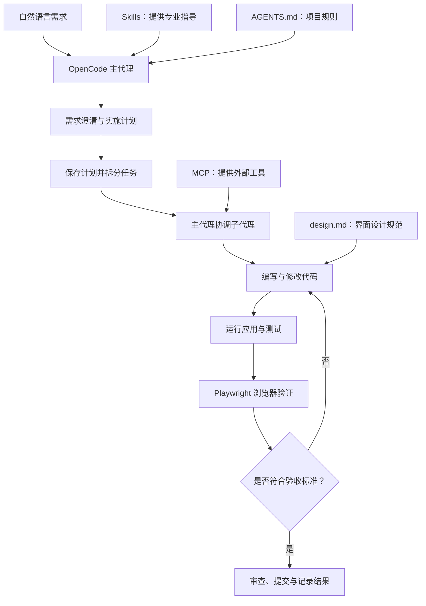

# OpenCode 新手教程与 AI 编程工作流

> [!summary] 核心结论
> OpenCode 的价值不只是生成代码，而是把需求分析、计划制定、代码实现、工具调用和测试验证串成一个可迭代的开发闭环。最值得复用的原则是：**先规划、用规则约束、按需拆分任务、最后验证结果。**

## 1. 视频信息

- **主题：** OpenCode 安装与配置、模型连接、Skills、`AGENTS.md`、子代理、MCP、Playwright 自动化测试。
- **时长：** 约 32 分钟。
- **原视频：** [OpenCode Tutorial for Beginners: Setup, Agents, Skills & MCP](https://www.youtube.com/watch?v=uZGDO0L-Dr4)
- **Bilibili：** [中文配音版视频](https://www.bilibili.com/video/BV1YGNm6MEaW/)
- **原作者：** Leon van Zyl。

## 2. OpenCode 是什么？

OpenCode 是一个开源的终端 AI 编程工具，可以连接不同的模型服务，并在项目工作目录中读取代码、编辑文件、运行命令和协助开发。

它与普通聊天式代码问答的区别在于：AI 不只是提供一段建议，而是可以在授权的项目环境中执行一系列开发操作。

基础工作流程：

1. 在终端或代码编辑器中打开项目目录。
2. 启动 OpenCode，并连接模型提供商。
3. 描述开发目标，让代理理解项目并完成任务。
4. 检查文件差异、运行结果和测试结果。
5. 根据反馈继续修复和迭代。

> [!note] 概念区分
> OpenCode 是代理运行与工具协调层；模型负责推理和生成内容。两者不是同一个概念。

## 3. 模型连接与费用

视频演示了免费模型，以及通过模型服务或符合条件的订阅连接模型的方式。

| 方式       | 特点                       | 适用场景       |
| -------- | ------------------------ | ---------- |
| 免费模型     | 成本低，但能力、额度、可用性和数据政策可能有限制 | 学习、试用、简单任务 |
| 订阅接入     | 取决于提供商支持的订阅和集成方式         | 持续使用、较复杂任务 |
| API 按量计费 | 通常按实际使用量计费，便于独立集成        | 应用开发和自动化调用 |

选择模型时要考虑任务难度、成本、速度、上下文容量和隐私要求。不要默认把敏感代码、密钥或个人数据交给免费模型；使用前应阅读服务条款和数据处理政策。

视频中的服务列表、免费额度和订阅兼容性属于特定时间的演示，实际使用时应以当前官方文档和账户页面为准。

## 4. Skills：为代理补充特定任务的指导

**Skill 可以理解为可复用的任务说明和专业指导。** 它通常包含用途描述、何时启用、操作要求以及必要参考资料，使代理在某类任务中更有针对性。

视频涉及的例子：（从skill.sh下载）

- **Frontend Design：** 改善界面设计与视觉一致性。
- **Next.js：** 提供 Next.js 项目的框架知识和实践指导。
- **AI SDK：** 协助遵循相关 SDK 的使用方式。
- **ShadCN：** 为组件库相关开发补充指导。

典型使用流程：

1. 根据当前项目栈寻找合适的 Skill。
2. 在项目层级安装或配置。
3. 检查代理是否识别到相应 Skill。
4. 通过任务要求让代理在适用场景下使用它。

**实践原则：按需安装，而不是越多越好。** Skill 本身也可能过期，关键 API 仍然要查阅官方文档并验证实际代码。

## 5. `AGENTS.md` 与 `design.md`：把规则写下来

### `AGENTS.md`

`AGENTS.md` 用于记录项目级代理指令，例如开发流程、代码风格、任务拆分规则和验证要求。OpenCode 可以按照其支持的配置机制读取这些指令。

可复用的示例：

```markdown
# 项目开发规范

- 回复简洁，优先给出结论和必要依据。
- 需求不明确时，先问必要的澄清问题。
- 复杂任务开始实现前，先提出实施计划。
- 优先复用现有代码和项目结构。
- 不要擅自偏离已经确认的需求和设计。
- 独立任务可以拆分并行执行；存在依赖时按顺序完成。
- 完成后运行适用的测试、类型检查和构建。
- 报告执行结果；不要声称运行过实际未执行的测试。
```

### `design.md`

视频用 `design.md` 保存 UI 设计系统，例如：

- 颜色与字体。
- 间距、边框、圆角和阴影。
- 组件的状态与使用约定。
- 页面布局与可访问性要求。

然后在代理规则中明确要求：创建或审查 UI 时遵循该设计系统。

二者分工：`AGENTS.md` 主要描述**代理如何工作**；`design.md` 主要描述**界面应该遵循什么设计标准**。


## 6. Subagents：把复杂任务分派给子代理

子代理可负责范围明确的子任务，例如代码调研、模块实现、测试、文档和代码审查。主代理负责总体协调、跟踪依赖并整合结果。

### 为什么需要子代理？

- 把复杂问题拆成更小、边界清晰的工作。
- 让独立任务有机会并行执行。
- 减少主代理上下文中不必要的过程细节。

### 使用时要注意

- 先分析任务依赖，再决定是否并行。
- 避免多个代理同时修改同一文件或同一接口。
- 为每个子任务定义输入、输出和验收条件。
- 最后由主代理整合，并运行实际检查。

子代理并不保证更快或更正确；任务拆分不合理时，反而会引入协调成本和冲突。

## 7. 先规划，再实现：项目开发流程

视频将项目规划与代码实现分成独立阶段。规划完成后，把计划保存到项目中的 `plans` 目录，再在新的会话中引用它，帮助减少上下文混乱。

推荐流程：

1. **输入需求：** 描述目标用户、问题和预期结果。
2. **澄清需求：** 确认功能边界、技术栈和关键设计选择。
3. **生成计划：** 列出架构、页面、数据模型、依赖和实施阶段。
4. **审查计划：** 检查遗漏、风险、依赖和过度设计。
5. **持久化计划：** 保存经确认的实施方案。
6. **执行开发：** 按阶段实现，必要时委派子代理。
7. **验证与迭代：** 运行测试、检查页面、修复问题并重复验证。

简单的小改动可以直接实施，不必机械套用全部流程。规划的目的是减少返工，不是为了增加仪式感。

## 8. MCP + Playwright：让代理使用浏览器进行测试

**MCP（Model Context Protocol）** 是一种让 AI 应用连接外部工具或资源的协议。工具的实际能力取决于所连接的 MCP 服务及其授权范围。

视频使用 Playwright MCP，让代理能够通过浏览器执行实际网页交互，例如：

- 打开本地开发站点。
- 输入文本、点击按钮和切换页面。
- 检查页面是否出现预期内容。
- 根据失败现象修改代码并再次测试。

这将工作流从“写完代码”拓展到“运行应用、交互验证、修复并复测”。

> [!warning] 自动化测试的边界
> 浏览器测试只能覆盖实际执行到的场景，不等于应用没有缺陷。应根据项目需要补充单元测试、集成测试、安全检查和人工验收。也应限制代理访问的文件、网络、终端命令和敏感数据。

## 9. 实战案例：AI Project Planner

视频中构建了一个 AI 项目规划器。用户输入粗略的应用想法，应用生成可编辑的项目概要和开发提示词。

生成内容包括：

- 项目名称、概述与目标用户。
- 核心功能列表。
- 推荐技术栈。
- 页面和路由。
- 数据模型及实体关系图。
- 实施阶段、风险和边界情况。
- 可复制给 AI 编程代理的启动提示词。

视频展示的技术组合包括 Next.js、Vercel AI SDK、OpenRouter、Zod 和 React Flow。

开发迭代中的两个重点改进：

1. 将一次性返回结果改为结构化的分段流式输出，让用户更早看到逐步生成的内容。
2. 将原始 JSON 数组改成卡片式编辑界面，使用户能查看、修改、添加或删除数据，而不是直接编辑难读的 JSON。

最后，作者接入 Playwright MCP，让代理在浏览器中自动操作应用并检查界面。

这个案例展示的是工具之间的协作方式，而不是必须照抄的一套技术栈。

## 10. 完整架构图



## 11. 我的学习路线

结合软件工程学习和后续个人项目，建议按以下顺序实践：

### 阶段一：基本使用与规则文件

- [ ] 在一个已有的小项目中尝试使用 OpenCode。
- [ ] 学会检查文件差异，不直接接受所有修改。
- [ ] 编写一份精简的 `AGENTS.md`，定义代码和验证规范。

### 阶段二：计划驱动开发

- [ ] 选择一个范围小的项目。
- [ ] 要求代理先输出实施计划。
- [ ] 人工检查计划后再开始实现。
- [ ] 对照计划检查实际改动与遗漏。

### 阶段三：测试闭环

- [ ] 先理解项目原本如何运行和测试。
- [ ] 为关键功能建立可重复的测试步骤。
- [ ] 再接入 Playwright 或其他合适的测试工具。
- [ ] 记录失败原因和复测结果。

### 阶段四：按需引入 Skills 与 Subagents

- [ ] 先识别实际重复出现的任务。
- [ ] 为当前技术栈安装少量可信、相关的 Skills。
- [ ] 仅把边界清楚、依赖明确的任务委派给子代理。
- [ ] 对所有代理的输出统一审查和验证。

对于 C/C++ 或嵌入式相关项目，也可以把类似流程用于阅读代码、梳理模块依赖、撰写文档和编写测试；涉及硬件、寄存器或时序的问题仍应结合数据手册、编译结果和实测验证。

## 12. 关键结论

1. **不要只让 AI 写代码，要让它参与规划、实现和验证。**
2. **把长期有效的规范写入项目文件，减少每次重复解释。**
3. **按需使用 Skills、Subagents 和 MCP，不要为了功能齐全而增加复杂度。**
4. **计划和自动化不能取代审查。** 始终检查差异、运行实际测试并核对结果。
5. **先建立简单可靠的闭环，再逐步提升自动化程度。**

## 13. 相关概念

- [[AI Agent]]
- [[AI 辅助编程]]
- [[OpenCode]]
- [[Model Context Protocol（MCP）]]
- [[Playwright]]
- [[软件工程]]
- [[提示工程]]

> [!quote] 一句话记忆
> **让 AI 按计划工作，用规则约束它，用工具扩展它，再用测试验证它。**

## 14.补充
记得和优秀的ai聊好合适的PROMPT.md提示词，然后plan模式下分给他，他会总结，然后build模式下让他保存在我们建立的plan文件夹下。然后将plan文件夹下的文件在build下让他执行。